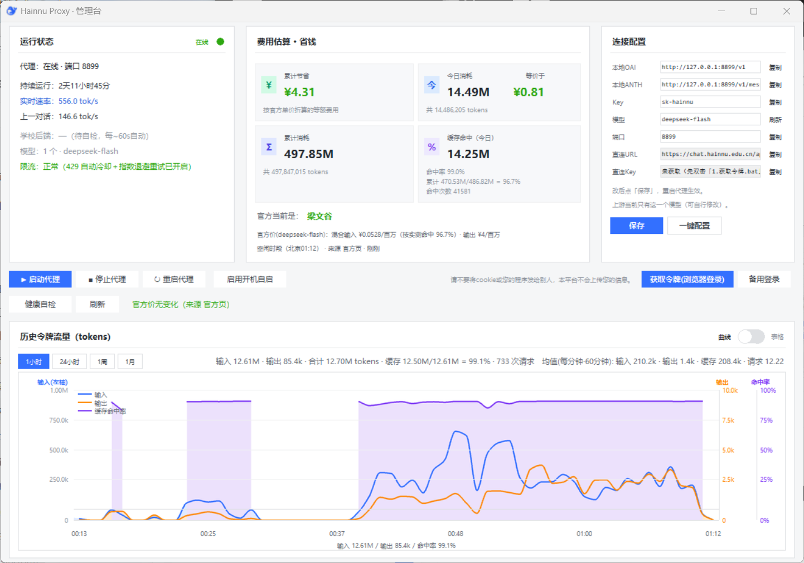

# Hainnu Proxy

把学校已部署的 DeepSeek 接到本机，提供 **OpenAI** 与 **Anthropic** 兼容接口。

> **仅限海南师范大学本校师生使用**（须能通过学校 CAS 登录）。
> 代码以 MIT 协议开源；**账号凭据与请求中转不在授权范围内**。
> 禁止外传 `token.txt` / JWT、禁止对外开放端口或为他人中转、禁止多人共用一份凭据。
> 完整条款见下方「许可」。

## 声明

**本库为纯粹 vibe coding 产物。**

**任何问题或想给我加学分请联系：<sapphirestar46@outlook.com>**

## 这是什么

学校 Open WebUI 只认登录 JWT，不认 API Key。本程序在 `127.0.0.1` 上补齐凭据、归一化协议并记录用量，另外还提供 Anthropic 的 `/v1/messages` 接口。权限与本人登录校园网页时相同。

```
客户端  →  127.0.0.1:8787  →  chat.hainnu.edu.cn/api/chat/completions
```

- 同时提供 OpenAI `/v1/chat/completions` 与 Anthropic `/v1/messages`
- 模型名跟随上游，上游改名后会自动重新解析
- 遇到限流会冷却并重试；用量和按官方价折算的成本可在管理台查看
- 采用异步转发，多路请求可以同时在途（上限仍取决于学校接口）

需要本地 Key、Anthropic 接口或用量面板时，通过本服务访问；OpenAI 兼容客户端也可以把 JWT 当作 apiKey **直连**上游（见[链路选择](docs/clients.md#链路选择)）。



## 快速开始

从 [Releases](https://github.com/sapphirestar46/hainnu-proxy/releases/latest) 下载发布包。**不要用仓库页面的 Code → Download ZIP**，这样下载的包里没有 `runtime\`。

| 包 | 说明 |
| --- | --- |
| `hainnu-proxy.zip` | 含便携 Python，解压即用 |
| `hainnu-proxy-scripts.zip` | 仅脚本，本机已有 Python 时用 |

解压后三步：

1. `1.获取令牌.bat` —— 在弹出的 Chrome 里用校园账号登录（唯一需要人工的步骤）
2. `2.启动代理.bat` —— **保持窗口开启**，看到 `[ready] http://127.0.0.1:8787/v1` 即启动完成
3. `3.自检.bat` —— 末尾应出现 `ALL TESTS PASSED`

图形界面用 `启动管理台.bat`；要给 opencode / WorkBuddy / DSH 一键写入配置，见[客户端配置](docs/clients.md)。

## 客户端怎么填

| | 值 |
| --- | --- |
| OpenAI Base URL | `http://127.0.0.1:8787/v1` |
| Anthropic Base URL | `http://127.0.0.1:8787` |
| API Key | `sk-hainnu` |
| 模型 | 任意；服务端会解析为上游真实 id（见 `/v1/models`） |

## 常见问题

**提示找不到 python，或 `runtime\` 缺失**
执行 `0.安装依赖.bat`（需要系统 Python 3.11+ 且在 PATH 中），或改用带便携 Python 的发布包。

**`auth_expired` / `401` / 提示没有令牌**
令牌缺失或已失效，重新执行 `1.获取令牌.bat`。

**返回 200 但 `content` 为空、`reasoning_content` 有内容**
输出上限被思考占用（思考 token 计入 `max_tokens`）。服务端有意不把思维链降级成正文，请提高 `max_tokens`（≥1500）或下调该客户端的思考档。

**`402 Server Connection Error`**
学校侧问题——浏览器此刻发消息也会报同样的错。联系学校信息中心，期间可执行 `7.恢复监测.bat` 持续探测。

**连本地端口返回 403 / 超时**
本机设了全局代理环境变量，回环请求被转发。设置 `NO_PROXY=localhost,127.0.0.1,::1`，curl 加 `--noproxy '*'`。

其余故障见[故障排查](docs/troubleshooting.md)。

## 文档

| 文档 | 内容 |
| --- | --- |
| [docs/install.md](docs/install.md) | 部署位置、依赖、令牌、启动方式、分发包 |
| [docs/clients.md](docs/clients.md) | OpenAI / Anthropic 参数、模型名解析、Agent 双链路、一键配置 |
| [docs/reference.md](docs/reference.md) | 上下文/输出上限、链路性能、`config.json`、思考档 |
| [docs/troubleshooting.md](docs/troubleshooting.md) | 常见故障 |
| [SECURITY.md](SECURITY.md) | 安全报告、凭据与日志 |
| [CONTRIBUTING.md](CONTRIBUTING.md) | 贡献范围与不会合并的改动 |
| [AGENT.md](AGENT.md) | 给 AI Agent 的部署指令与红线 |

## 许可

代码采用 **MIT** 协议（见 [`LICENSE`](LICENSE)）。凭据与中转行为不在该授权范围内：服务只监听 `127.0.0.1`，请求以本人校园账号发出，违规后果由本人承担。详见首部约束与 [SECURITY.md](SECURITY.md)。

上游基于 [Open WebUI](https://github.com/open-webui/open-webui)。
